# Member C personal deployment handover (24 October 2026)

Latest status: [the 25 October attempt record](c-runtime-attempt-and-recovery-20261025.md) supersedes the historical state/count examples below. Attempt3 applied94c once, paused all eight controls on time, then failed its continuous observation tail; media/WIF success remains0. Current saved raw state is serial94/60 instances and is not yet reconciled to the live API pause. Checkpoint51 changes only inert source/tests/documentation, not cloud source47 or the frozen V14 runtime.

The current route uses AWS for storage, queues, identity and application functions, and Google Cloud Run for private model inference. These are two cloud providers; the older Oracle-host instructions describe a separate deployment route. This handover identifies the current environment and separates deployed configuration from application acceptance.

```mermaid
flowchart LR
  User[Team web client] -. pending HTTPS/Cognito acceptance .-> API[AWS API and functions]
  API -. pending actual media processing .-> S3[Private AWS media bucket]
  S3 -. disabled notifications .-> Q[Queues and ingest Lambda]
  Q -. pending role-token exchange .-> WIF[Google Workload Identity Federation]
  WIF --> SA[Dedicated AWS-invoker Google service account]
  SA --> Run[Private Cloud Run inference]
  Run --> HF[Exact locked model artifacts over HTTPS]
```

The [later read-only integration checkpoint](c-readonly-integration-checkpoint-20261024.md)
records the source47 transition, reviewed native processing plan and successful
11:42 UTC AWS collection. The historical next-operation descriptions below must
not be interpreted as current runtime approval; actual media processing remains pending.

The dotted paths still need real application evidence. A configured IAM relationship or Ready revision alone does not prove that Lambda has exchanged its role identity or processed media.

| Environment | State-owning source and latest recorded configuration | Evidence |
| --- | --- | --- |
| AWS `011154879765`, `us-east-1` | State-owning source `3d2b3e7d64e43bfe0808f94ce06ed693be4ef268`; 59 resources, serial76; one repair apply exited0; independent full configuration and 34/34 pause audit passed at 07:45:33 UTC | [Actual paused wiring deployment](c-aws-wiring-deployed-paused-20261024.md), [historical partial apply](c-aws-wiring-partial-apply-20261024.md) |
| Google `ecoguard-fit3184-a2-2026`, `us-central1` | 13 resources; dedicated runtime and invoker accounts; private Run service, 4 CPU/8 GiB, minimum 0/maximum 1 | [Actual Run configuration](c-private-inference-deployed-20261024.md) |
| Inference repair | Source `ac7757717486b3db2da8c955ebffcc01f6807724`; image3 private publication and image-only apply passed; Ready revision `ecoguard-inference-00003-jwb`, state serial21; authenticated model warmup returned 200 and both locked models are ready | [Image3 apply](c-inference-image3-apply-20261024.md), [actual warmup](c-inference-image3-warmup-20261024.md) |

The recorded service URL is `https://ecoguard-inference-adlnb7yumq-uc.a.run.app`. The first anonymous `/healthz` request returned 404, and the test stopped before authenticated health or model warmup. The repair adds `/health` and `/ready`; the [new bounded batch](c-private-http-repair-20261024.md) returned 403/200/401 for anonymous health/authenticated health/warmup. After the private Cloud Run authentication adapter repair, a separate single warmup POST returned 200 in 87.694 seconds and loaded the locked detector and embedding models. The new check made no health GET or anonymous probe. Preserve the [original failure](c-private-http-first-attempt-20261024.md) and the earlier 401 alongside the new [model warmup result](c-inference-image3-warmup-20261024.md). Warmup does not establish inference or the Lambda federation path.

## Identity and source custody

Only the intended normalized AWS execution role is trusted by the Google provider. The Google invoker is `ecoguard-aws-invoker@ecoguard-fit3184-a2-2026.iam.gserviceaccount.com`, and the runtime uses its separate dedicated account. Live configuration checks recorded zero user-managed service-account keys. The service has a sole explicit invoker binding; no anonymous invoker grant was added.

Each cloud's existing CloudShell checkout at `~/ecoguard-c-personal-20261023/source` owns that cloud's personal-root state. The state and retained plans/logs remain private. Git transfers source and selected evidence, so a second checkout cannot apply safely merely because it contains the same code. Arrange private state custody and one operator before handover. Every saved binary is bound to its source, image digest, state checkpoint and reviewed scope. Historical first-create plans remain historical records.

The private repository is [xihan-u/aussie-ecoguard-fit3184-a2-private](https://github.com/xihan-u/aussie-ecoguard-fit3184-a2-private). Both `main` and `codex/c-cloud-deployment` receive member-C checkpoints. Team and teaching-staff access still needs the intended recipients; see [repository handoff](c-private-repository-handoff-20261024.md). Existing public upstream/fork exposure remains a separate unresolved requirement.

## Budget, pause and recovery

Additional personal spending remains A$0. The current Google credit observation expires on 28 October, with review/cleanup due by 27 October Melbourne. Recheck live eligible credits and the selected billing identity before each bounded activation. Minimum-zero instances and a one-instance cap reduce runtime use, but they are not a hard account-wide spending cap. Registry images and retained cloud data can incur storage charges. No automatic cleanup is configured.

AWS remains paused after the completed narrow repair: all eight functions have zero reserved concurrency, all four queue mappings and both schedules are disabled, the API endpoint is disabled, self-signup is restricted and S3 retains its explicit paused-data denial with no notifications. The scoped ECR pull policy, Image-based ingest function and disabled ingest mapping now exist. The actual checkpoint is 59 resources/serial76. The [independent after-only audit](c-aws-wiring-deployed-paused-20261024.md) checked every old56 value against the reviewed refreshed prior, all new3 configured fields and unknown masks, and fresh paused controls. No runtime, media or model request was started by the repair or its verification.

The [ingest image publication](c-aws-ingest-publication-20261024.md), [inventory recovery](c-aws-paused-inventory-recovered-20261024.md), [state-only synchronization](c-aws-state-sync-20261024.md), and [saved wiring plan review](c-aws-paused-wiring-saved-plan-review-20261024.md) remain separate historical evidence. The earlier 70 offline infrastructure checks and all failures remain recorded. Both consumed wiring/repair binaries must never be replayed. The original repair command exited0, but its post-check rejected provider representations; that blocked receipt is preserved alongside the separate successful read-only audit. A deployed, paused ingest function does not establish actual Lambda federation or media processing.

The state-owning AWS source moved to the reviewed repair revision at 04:19:17 UTC without a state or resource change. The 04:22 UTC normal refreshed repair plan passed [independent review](c-aws-wiring-repair-saved-plan-review-20261024.md) on its unchanged native binary: three creates, 56 no-ops and two explicit provider read observations. After the user's new action-time confirmation, the saved binary was applied once. The independent after-only audit passed at 07:45:33 UTC. Official tooling was restored after another CloudShell reconnect; initialization/validation preserved the actual59 state and historical backend metadata. Tool restoration is separate from deployment and runtime acceptance.

The account's actual regional Lambda concurrency limit is 10, observed through `GetAccountSettings`. A future bounded processing configuration must accommodate that limit. The earlier proposed positive reservations are superseded by a separately reviewed low-quota candidate; no quota request, billing upgrade or processing activation has occurred.

For a repair rollback, retain the prior immutable image and its exact manifest. Generate a new image-only plan against the actual current state, review configuration/IAM/capacity preservation, and apply that new binary once under the applicable authorization and funding. An older already-applied saved plan is not a rollback mechanism. Keep the service's dedicated runtime identity, sole invoker, locked model manifest and resource bounds. Validate the resulting Ready revision and authenticated behavior.

Pause/restore acceptance still needs a real exercise after the cross-cloud path works: record a bounded task, pause producers and processing, verify the paused controls, restore only the intended stage, then show the intended recovery and cleanup. These instructions are a procedure, not evidence that this exercise has run. The Week 15 demonstration needs a funding-compatible run/restore arrangement beyond the present credit-expiry date.

## Remaining member-C integration evidence

The next member-C evidence is one real image following the automatic S3 -> ingest -> outbox -> infer -> Lambda-role federation -> private Run -> stored-result path, followed by the pause/restore exercise. The bounded processing implementation has passed offline tests but has no actual saved activation plan or runtime permission yet. Coordinate the web gallery, signup/login, browser CORS and cross-user checks with B, video acceptance with A/D, and Lex/mail acceptance with D. The complete assignment's 22 criteria remain separate from this infrastructure work.
