# Member C personal deployment handover (24 October 2026)

The current route uses AWS for storage, queues, identity and application functions, and Google Cloud Run for private model inference. These are two cloud providers; the older Oracle-host instructions describe a separate deployment route. This handover identifies the current environment and separates deployed configuration from application acceptance.

```mermaid
flowchart LR
  User[Team web client] -. pending HTTPS/Cognito acceptance .-> API[AWS API and functions]
  API -. pending actual media processing .-> S3[Private AWS media bucket]
  S3 -. disabled notifications .-> Q[Queues and ingest Lambda]
  Q -. pending role-token exchange .-> WIF[Google Workload Identity Federation]
  WIF --> SA[Dedicated AWS-invoker Google service account]
  SA --> Run[Private Cloud Run inference]
  Run --> HF[Exact locked model artifacts over HTTPS]
```

The dotted paths still need real application evidence. A configured IAM relationship or Ready revision alone does not prove that Lambda has exchanged its role identity or processed media.

| Environment | State-owning source and latest recorded configuration | Evidence |
| --- | --- | --- |
| AWS `011154879765`, `us-east-1` | Source `30ae7066bbc24eb5af243c12c662e976edfb8f35`; 55 resources, state serial61; reviewed state-only sync completed at 02:11:31 UTC, with 34/34 live control checks before and after | [Foundation](c-personal-foundation-deployed-20261024.md), [state synchronization](c-aws-state-sync-20261024.md) |
| Google `ecoguard-fit3184-a2-2026`, `us-central1` | 13 resources; dedicated runtime and invoker accounts; private Run service, 4 CPU/8 GiB, minimum 0/maximum 1 | [Actual Run configuration](c-private-inference-deployed-20261024.md) |
| Inference repair | Source `ac7757717486b3db2da8c955ebffcc01f6807724`; image3 private publication and image-only apply passed; Ready revision `ecoguard-inference-00003-jwb`, state serial21; authenticated model warmup returned 200 and both locked models are ready | [Image3 apply](c-inference-image3-apply-20261024.md), [actual warmup](c-inference-image3-warmup-20261024.md) |

The recorded service URL is `https://ecoguard-inference-adlnb7yumq-uc.a.run.app`. The first anonymous `/healthz` request returned 404, and the test stopped before authenticated health or model warmup. The repair adds `/health` and `/ready`; the [new bounded batch](c-private-http-repair-20261024.md) returned 403/200/401 for anonymous health/authenticated health/warmup. After the private Cloud Run authentication adapter repair, a separate single warmup POST returned 200 in 87.694 seconds and loaded the locked detector and embedding models. The new check made no health GET or anonymous probe. Preserve the [original failure](c-private-http-first-attempt-20261024.md) and the earlier 401 alongside the new [model warmup result](c-inference-image3-warmup-20261024.md). Warmup does not establish inference or the Lambda federation path.

## Identity and source custody

Only the intended normalized AWS execution role is trusted by the Google provider. The Google invoker is `ecoguard-aws-invoker@ecoguard-fit3184-a2-2026.iam.gserviceaccount.com`, and the runtime uses its separate dedicated account. Live configuration checks recorded zero user-managed service-account keys. The service has a sole explicit invoker binding; no anonymous invoker grant was added.

Each cloud's existing CloudShell checkout at `~/ecoguard-c-personal-20261023/source` owns that cloud's personal-root state. The state and retained plans/logs remain private. Git transfers source and selected evidence, so a second checkout cannot apply safely merely because it contains the same code. Arrange private state custody and one operator before handover. Every saved binary is bound to its source, image digest, state checkpoint and reviewed scope. Historical first-create plans remain historical records.

The private repository is [xihan-u/aussie-ecoguard-fit3184-a2-private](https://github.com/xihan-u/aussie-ecoguard-fit3184-a2-private). Both `main` and `codex/c-cloud-deployment` receive member-C checkpoints. Team and teaching-staff access still needs the intended recipients; see [repository handoff](c-private-repository-handoff-20261024.md). Existing public upstream/fork exposure remains a separate unresolved requirement.

## Budget, pause and recovery

Additional personal spending remains A$0. The current Google credit observation expires on 28 October, with review/cleanup due by 27 October Melbourne. Recheck live eligible credits and the selected billing identity before each bounded activation. Minimum-zero instances and a one-instance cap reduce runtime use, but they are not a hard account-wide spending cap. Registry images and retained cloud data can incur storage charges. No automatic cleanup is configured.

AWS is recorded paused: seven functions have zero reserved concurrency, three queue consumers and both schedules are disabled, the default API endpoint is disabled, self-signup is restricted and S3 retains its explicit paused-data denial. Resume stages need reviewed incremental plans and current account/credit checks. The prepared ingest archive is [locally verified](c-aws-ingest-export-20261024.md). The [private ECR publication](c-aws-ingest-publication-20261024.md) passed one push and complete byte readback; all 40 paused checks passed before and after. Its earlier zero-push preflight failure is retained. The staged wiring implementation is committed with 59 local AWS infrastructure tests passing, and a real wiring plan was generated, but its strict review rejected false S3 bucket recreation. No wiring apply has run. The approved [inventory recovery](c-aws-paused-inventory-recovered-20261024.md) passed an independent read-only audit: HeadBucket200, full privacy unchanged, and only root bucket listing excepted. Its original parsing and representation failures are retained. The separately reviewed [refresh-only synchronization](c-aws-state-sync-20261024.md) has now recorded that policy and the exact provider observations in state serial61, with 34 live checks before and after and no cloud-resource actions. A new wiring plan is still required; its apply needs a separate concrete permission review. The second real wiring plan also stopped on unknown new-resource defaults; the [local defaults repair](c-aws-wiring-known-defaults-20261024.md) preserves that failure and still needs a new real plan. ECR publication and the managed ingest runtime require separate results.

For a repair rollback, retain the prior immutable image and its exact manifest. Generate a new image-only plan against the actual current state, review configuration/IAM/capacity preservation, and apply that new binary once under the applicable authorization and funding. An older already-applied saved plan is not a rollback mechanism. Keep the service's dedicated runtime identity, sole invoker, locked model manifest and resource bounds. Validate the resulting Ready revision and authenticated behavior.

Pause/restore acceptance still needs a real exercise after the cross-cloud path works: record a bounded task, pause producers and processing, verify the paused controls, restore only the intended stage, then show the intended recovery and cleanup. These instructions are a procedure, not evidence that this exercise has run. The Week 15 demonstration needs a funding-compatible run/restore arrangement beyond the present credit-expiry date.

## Remaining member-C integration evidence

The next evidence should cover deployment of the published AWS ingest image, actual Lambda-role federation, real image/video processing, TLS/CORS and cross-user boundaries, plus the pause/restore exercise. Coordinate browser signup/login with B and formal Lex/mail acceptance with D. The complete assignment's 22 criteria remain separate from this infrastructure work.
